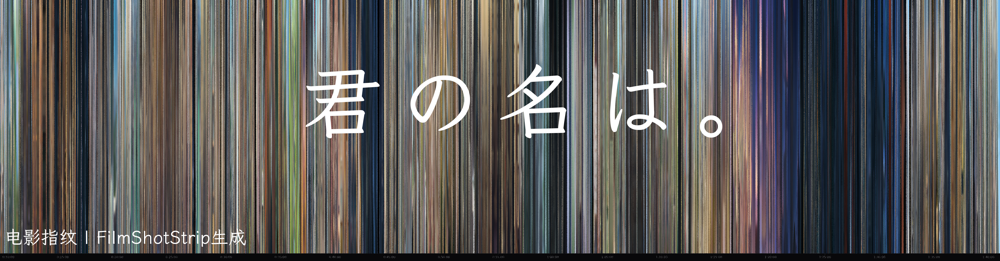
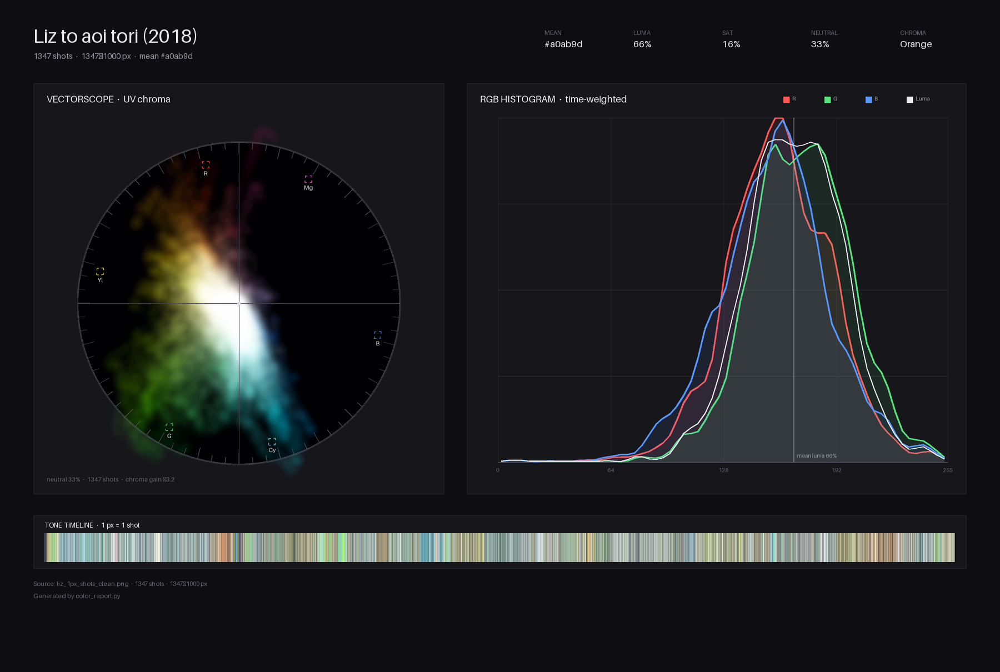

# FilmShotStrip

> <em>致从未以如此方式观看一部电影的你我</em>



横向读是时间，纵向读是画面，可以一眼看到整部片的色彩走向。

当前版本：`1.9.1`（`python3 film_shot_strip.py -V`）


## 特性

- **按分镜切分**：默认优先 PySceneDetect；没安装或 OpenCV 无法解码时自动回退到 ffmpeg `scdet`。
- **宽度就是时间**：镜头越久，色带越宽；也支持等宽、固定像素、每秒一帧。
- **三种画法**：`gradient` 竖向渐变色带、`dominant` 单色块、`frame` 真实画面缩略。
- **一分镜一像素**：把上千个镜头压成一条窄图，适合比较不同影片的色调。

## 安装

需要 **ffmpeg / ffprobe（必须）** 和 Python 3.9+。

```bash
# Python 依赖
python3 -m venv .venv
source .venv/bin/activate
pip install -r requirements.txt
```

`requirements.txt` 包含 `numpy`、`Pillow` 和推荐的 `scenedetect[opencv]`。
PySceneDetect 是可选依赖：不安装也能运行，`--method auto` 会回退到 ffmpeg 的 `scdet`。
无桌面环境可用 `pip install scenedetect opencv-python-headless`。

## 快速开始

如果暂时没有视频，可以通过 `make_demo.sh` 生成一个35秒12镜头的样片：

```bash
bash make_demo.sh
```

从视频生成一张带时间轴的长图：

```bash
python3 film_shot_strip.py path/to/a/movie.mp4 -o out/output.jpg --target-width 4000 --height 720
```

输出：

```text
out/output.jpg           长图 4000×762（720 + 42px 时间轴）
out/output_preview.jpg   预览图（总宽超过 --preview-width 时才有）
out/movie_shots.json          分镜清单
```

默认输出当前目录的 `<片源名>_strip.jpg`；分镜清单写到 `out/`，缓存写到 `out/.cache/`。

## 四种排布方式

详情见 [像素排列方式](docs/像素排列方式.md)

优先级：`--per-second` > `--equal-width` > `--px-per-shot` > 默认时长比例。

| 方式 | 开启 | 横向宽度代表 | 用途 |
|---|---|---|---|
| 时长比例（默认） | 不加参数 | 分镜时长 | 看整部片的节奏与色调 |
| 每秒一帧 | `--per-second [PX]` | 固定 1 秒 = PX 像素 | 快速总览、做色彩报告 |
| 固定像素 | `--px-per-shot N` | 每个取色帧 N 像素 | 一分镜一像素、色带指纹 |
| 等宽 | `--equal-width` | 每个分镜相同宽度 | 只比较镜头色彩，不比较时长 |

## 三种渲染样式

| `--style` | 效果 | 说明 |
|---|---|---|
| `gradient`（默认） | 竖向渐变色带 | 镜头内部按时间展开，纵向是该帧画面的行平均色 |
| `dominant` | 单色块 | 每个分镜填一个代表色 |
| `frame` | 真实画面 | 用每个分镜的中间帧拼成胶片条 |

```bash
# 单色块
python3 film_shot_strip.py 电影.mkv --style dominant -o out/film_blocks.png

# 真实画面：需要更宽的采样，推荐把图做大一点
python3 film_shot_strip.py 电影.mkv --style frame --target-width 24000 -o out/film_frames.jpg
```

- `frame` 的缩略图默认来自约 480px 宽的采样帧，不是原分辨率；要改采样参数需配合 `--refresh-shots`。
- `frame` 不能和 `--per-second` 一起用。
- `gradient` / `dominant` 默认采样宽度是 160px；只影响取色精度和速度。


## 色调报告：color_report.py

如果你不想打开达芬奇或其他软件分析输出结果，`color_report.py` 从「每秒一帧」的图生成一张分析报告：矢量示波器（类似 DaVinci Resolve）、
RGB/亮度直方图、色调时间线，以及平均色、亮度、饱和度、中性色比例、主色相。



```bash
# 每秒图（不要带刻度，以免干扰色调分析）
python3 film_shot_strip.py 电影.mkv --per-second 1 --no-ruler -o out/film_1s.png --height 1080

# 生成报告
python3 color_report.py out/film_1s.png -o out/film_color_report.png --title "电影标题 (年份)" --unit second
```

输出：

- `out/film_color_report.png`：1800×1210 的合成报告；
- `out/film_color_report_vectorscope.png`：单独的矢量示波器；
- `out/film_color_report_hist.png`：单独的 RGB / 亮度直方图。

参数说明：

| 参数 | 默认 | 说明 |
|---|---|---|
| `image` | 必填 | 每秒图（`--per-second` 的输出） |
| `-o, --output` | `<输入>_color_report.png` | 报告输出路径 |
| `--px-per-second` | 1 | 每秒图里每秒占多少像素；`--per-second 3` 的图传 3 |
| `--crop-bottom` | 0 | 裁掉底部刻度条；普通刻度 42px，映射刻度 44px |
| `--title` | 输入文件名 | 报告标题 |
| `--unit` | `second` | `second` 或 `shot`；一分镜一列的图用 `shot` |
| `--scope-size` | 740 | 矢量示波器边长 |
| `--chroma-gain` | 0 | 色度云增益；0 = 按 99 百分位自动 |

> `--unit shot` 适合 `--shot-samples avg` 的一分镜一列图；`fml` 的三列图不要用。

## 从每秒缓存聚合：derive_shots.py

如果已经跑过 `--per-second`，但不想再花一遍全片解码做镜头检测，可以用
`derive_shots.py` 在每秒颜色序列上找切点，再把每个镜头内的秒平均成 1 列。

```bash
# 找到缓存前缀（去掉 .shots.json 后缀）
ls out/.cache/*.persecond.shots.json

# 假设前缀是 out/.cache/film.persecond
python3 derive_shots.py --cache out/.cache/film.persecond --output out/film_derived_1px.png --height 1000 --fps 23.976 --min-shot 2.0 --ruler
```

输出：

- `out/film_derived_1px.png`：图宽 = 分镜数（每个分镜 1 列）；
- `out/film_derived_1px_shots.json`：帧数格式的分镜清单，`width_px` 固定为 1。

说明：

- 不会重新解码视频，只读 `.persecond.shots.json` 和 `.persecond.traces.npz`；
- 切点基于每秒颜色的差分和局部中位数阈值，比 PySceneDetect 粗，适合快速出图；
- `--fps` 要和片源一致；默认 23.976；
- 清单里没有代表色；需要色调报告可再用 `color_report.py --unit shot`（带刻度时加 `--crop-bottom 44`）。

## 输出文件

| 文件 | 说明 |
|---|---|
| `<输出名>.<ext>` | 长图。总宽超过 `--max-width` 时拆成 `<输出名>_01.<ext>`、`_02`… |
| `<输出名>_preview.jpg` | 预览图。只有需要缩小（超过 `--preview-width` 或 `--preview-height`）时才生成 |
| `<片源名>_shots.json` | 分镜清单，写在 `--shots-dir`（默认 `out/`） |
| `<片源名>_persecond_shots.json` | 每秒一帧模式的清单 |
| `out/.cache/<片源名>*.shots.json` | 分镜检测缓存 |
| `out/.cache/<片源名>*.traces.npz` | 色带、缩略图、首/中/末帧缓存 |

- `-o` 只给前缀时补 `.jpg`；给 `.jpg` / `.png` / `.webp` 时按扩展名保存。
- `<片源名>` 是输入文件名去掉扩展名并做文件名安全化后的结果；同一片源只保留一份清单，后一次运行覆盖。
- 完成后长图、预览、清单的路径会打印到 stdout；日志和进度在 stderr。

使用 `-o out/...` 时，目录通常如下：

```text
out/
  <片源名>_shots.json
  <片源名>_persecond_shots.json
  .cache/
    <片源名>.shots.json
    <片源名>.traces.npz
    <片源名>.persecond.shots.json
    <片源名>.persecond.traces.npz
  film.jpg / film_preview.jpg / ...
```

## 分镜清单 JSON

示例（字段有删减）：

```json
{
  "video": "/path/to/电影.mkv",
  "source_hash": "sha256:...",
  "time_unit": "frames",
  "fps": 23.976024,
  "frame_count": 130201,
  "duration_seconds": 5430.449,
  "px_per_second": 2.578,
  "image_height": 1080,
  "style": "gradient",
  "method": "auto",
  "detector": "content",
  "scene_threshold": 0.35,
  "min_shot": 0.6,
  "merge_similar": 0,
  "px_per_shot": 0,
  "shot_samples": "fml",
  "equal_width": false,
  "mode": "shots",
  "per_second_px": null,
  "cached_shots": true,
  "cached_traces": true,
  "total_width": 14000,
  "outputs": ["out/电影.jpg"],
  "shots": [
    {
      "index": 0,
      "start": 0,
      "end": 360,
      "duration": 360,
      "color": "#496a8b",
      "width_px": 39
    }
  ]
}
```

- `start` / `end` / `duration` 都是**帧数**。
- `color` 是该分镜所有色带样本逐通道取中位数得到的代表色。
- `width_px` 是本次排版中该分镜实际占的像素宽度。
- `image_height` 是画面高度，不含底部刻度条。
- `mode` 为 `shots` 或 `per_second`；每秒模式还会有 `per_second_px`。
- `outputs` 是本次实际写出的长图路径；预览图和清单本身不包含在里面。
- `--no-json` 只关闭清单输出，不影响缓存。

## 缓存

首次运行会对片源做一次完整 SHA-256，然后在 `out/.cache/` 写入：

- `<片源名>.shots.json`：片源哈希、帧率、帧区间、检测参数、每个分镜的代表色；
- `<片源名>.traces.npz`：每个分镜的色带；`frame` 的缩略图；`fml` 的首/中/末帧；
- 每秒一帧模式使用 `.persecond.shots.json` / `.persecond.traces.npz`，与普通分镜互不影响。

再次渲染同一片源时：

- 先重新计算哈希（**大文件每次都会完整读一遍**），哈希、检测参数、缓存版本都一致才命中；
- 命中且色带缓存可用时，跳过镜头检测和色带采样，只重新排版/渲染，所以改宽度、高度、样式、刻度通常很快；
- 如果缓存里缺少 `frame` 缩略图或 `fml` 首/中/末帧，会额外扫一遍补取；
- 改了检测参数（`--scene-threshold`、`--min-shot`、`--max-shot`、`--method`、`--detector` 等）会自动失效；
- `--merge-similar` 在缓存之后应用，不会让缓存失效；
- `--sample-fps` / `--sample-width` 不在缓存键里，改了不会自动重采样，需要加 `--refresh-shots` 或 `--no-cache`。

```bash
# 强制重新检测 + 重新采样
python3 film_shot_strip.py 电影.mkv --refresh-shots

# 完全不读写缓存（也跳过片源哈希）
python3 film_shot_strip.py 电影.mkv --no-cache

# 换缓存目录 / 清单目录
python3 film_shot_strip.py 电影.mkv \
  --cache-dir cache --shots-dir out
```

## 参数

完整参数见 `python3 film_shot_strip.py -h`或
[参数说明](docs/参数.md)

## 项目结构

```text
FilmShotStrip/
├── film_shot_strip.py    主程序：检测、采样、排版、渲染、缓存
├── color_report.py       色调报告：矢量示波器、直方图、时间线
├── derive_shots.py       从每秒缓存聚合「一分镜一列」
├── make_demo.sh          生成测试样片
├── docs/                 说明文档与示例图
├── out/                  默认缓存目录，也常用来放输出（不入库）
└── requirements.txt
```

## 致谢

灵感来自：[FilmToLongPicture](https://github.com/yyyeying/FilmToLongPicture)

示例图片生成自以下片源：    
- [[桜都字幕组] 学生会也有洞！ / Seitokai ni mo Ana wa Aru！ [04][1080P][简繁内封]](https://mikanani.me/Home/Episode/c1e42b07106ac573dc00c35c6cc39701322991dc)
- [[7³ACG] 电影版 吹响吧！上低音号～莉兹与青鸟～/Liz to aoi tori 2018 [简繁字幕] BDrip 1080p AV1 OPUS 2.0](https://dmhy.org/topics/view/726034_7_ACG_Liz_to_aoi_tori_2018_BDrip_1080p_AV1_OPUS_2_0.html)
- [[❀拨雪寻春❀] 你的名字 / 君の名は。 / Kimi no Na wa. / Your Name. [BDRip][HEVC-10bit 1080p][简繁日内封]](https://mikanani.me/Home/Episode/261af5f2e1162e6e43eb2727e63cd159f49c642a)
