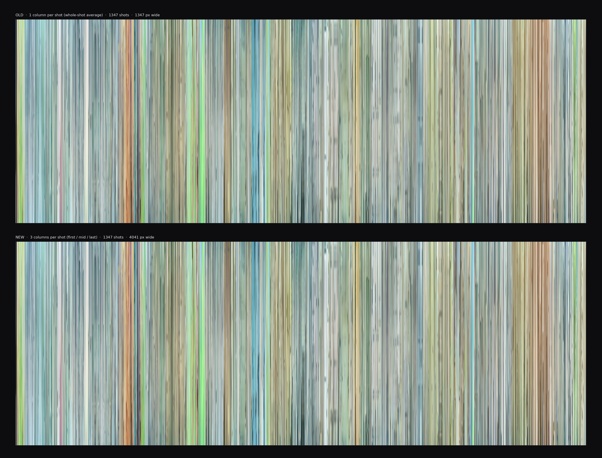
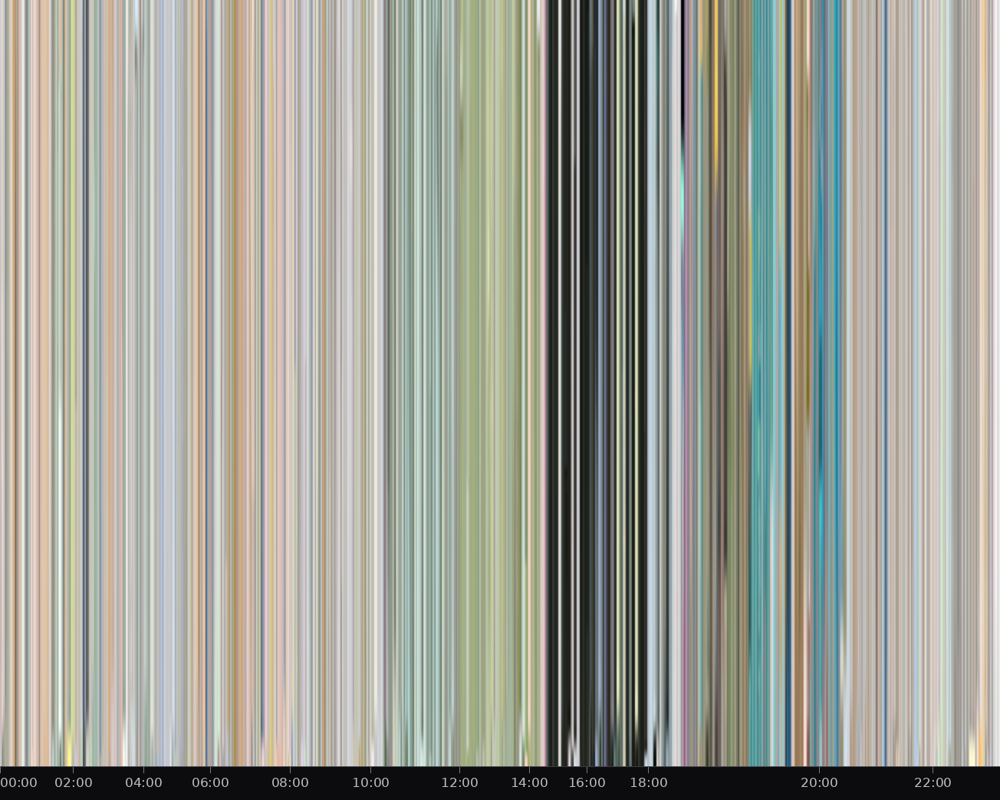

## 1. 默认：宽度与时长成正比

```bash
# 目标总宽 16000，高 1080
python3 film_shot_strip.py 电影.mkv -o out/film.jpg \
  --target-width 16000 --height 1080

# 直接指定时间比例：每秒 4 像素
python3 film_shot_strip.py 电影.mkv -o out/film_4pps.jpg \
  --px-per-second 4 --height 1080
```

- `--px-per-second auto`（默认）由 `--target-width` 反推，并限制在 0.5–120 px/s；
  所以 `--target-width` 是目标值，不保证精确命中。
- 每个分镜至少 `--min-shot-px`（默认 2）像素宽，取整用最大余数法补齐。
- 输出总宽超过 `--max-width`（默认 24000）时自动切成 `<名>_01.jpg`、`<名>_02.jpg`……

## 2. 一分镜一像素 / 固定像素

`--px-per-shot N` 让每个「取色帧」固定 N 像素宽，不再按时间比例。    
默认 `--shot-samples fml`，每镜取首帧、中间帧、末帧各一列，所以每镜宽 `3 × N`；
改用 `--shot-samples avg` 时不拆帧，每镜只占 `N` 像素（常用 N=1，即整镜平均色；
N>1 时在默认 `gradient` 下会把整镜色带压到 N 列）。



```bash
# 每个分镜 1 列（整镜平均），图宽 = 分镜数
python3 film_shot_strip.py 电影.mkv \
  --px-per-shot 1 --shot-samples avg \
  -o out/film_1px.png --height 1000

# 每个分镜 3 列（首/中/末帧，默认），图宽 = 3 × 分镜数
python3 film_shot_strip.py 电影.mkv \
  --px-per-shot 1 -o out/film_fml.png --height 1000

# 每列 4px，每镜 12px；更粗、更适合手机看
python3 film_shot_strip.py 电影.mkv \
  --px-per-shot 4 -o out/film_wide.png --height 1000
```



- 这个模式没有「时间线性」：刻度会按镜头在总宽中的位置映射回原片时间（`--ruler` 默认开）。
- 总宽小于 300px 时自动跳过刻度。
- `--px-per-shot 1` 会自动关闭整图柔化，避免相邻分镜混色；建议输出 PNG。
- 首/中/末帧取的是离起点、中点、终点最近的**采样帧**，不是精确帧号；提高 `--sample-fps` 会更准
  （已缓存时需配合 `--refresh-shots`）。
- `--height` 不指定时默认 1000。

## 3. 每秒一帧

`--per-second [PX]` 跳过镜头检测，每秒抽 1 帧，每帧占 PX 像素（默认 1）。
图宽约等于 `秒数 × PX`，高度仍用 `--height`，适合先快速看一遍全片色彩，再跑精细分镜。

```bash
# 1 秒 = 1 像素（长片会是一条很窄的图，建议 PNG）
python3 film_shot_strip.py 电影.mkv --per-second -o out/film_1s.png

# 1 秒 = 3 像素
python3 film_shot_strip.py 电影.mkv --per-second 3 -o out/film_1s_x3.png

# 不要刻度，方便直接拿去做色彩分析
python3 film_shot_strip.py 电影.mkv --per-second 1 --no-ruler -o out/film_1s_clean.png
```

- 只支持 `gradient` / `dominant`；`--style frame` 会直接报错。
- `--per-second 1` 会自动关闭整图柔化。
- 分镜相关参数（`--scene-threshold`、`--min-shot`、`--max-shot`、`--merge-similar` 等）在这一模式下不生效。
- 缓存和清单都带 `persecond` 后缀，与普通分镜互不影响：
  `out/.cache/<片源名>.persecond.*`、`out/<片源名>_persecond_shots.json`。

## 4. 等宽

```bash
python3 film_shot_strip.py 电影.mkv \
  --equal-width --target-width 6000 -o out/film_equal.png
```

每个分镜占同样宽度，总宽为 `--target-width`（当它不小于分镜数时）；适合比较「这部片每个镜头是什么颜色」。
刻度同样按分镜位置映射，总宽小于 300px 时跳过。
